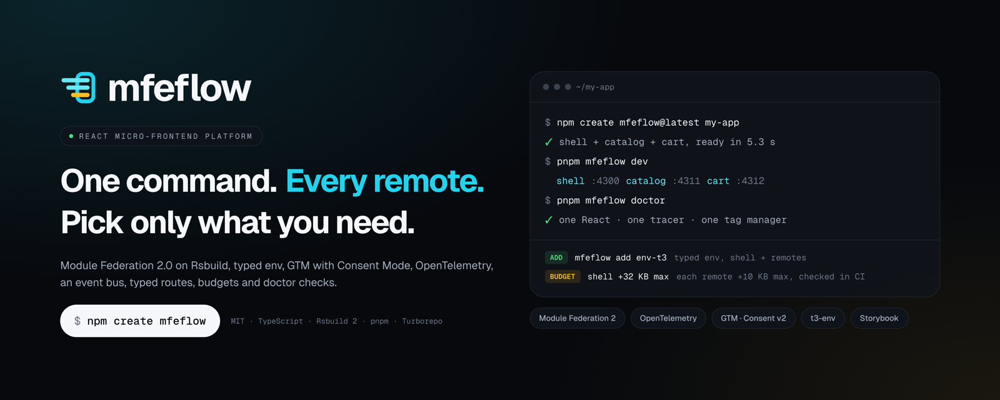
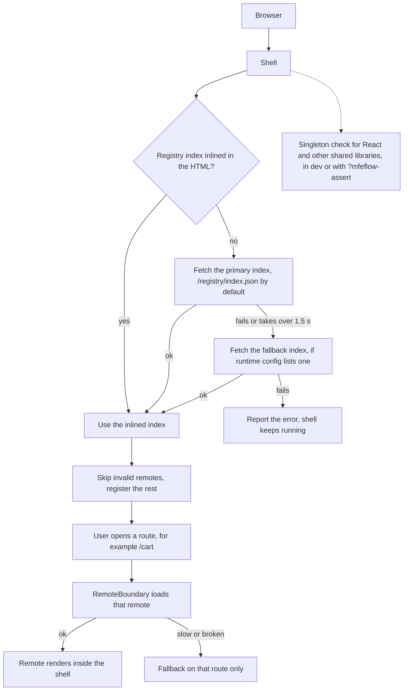
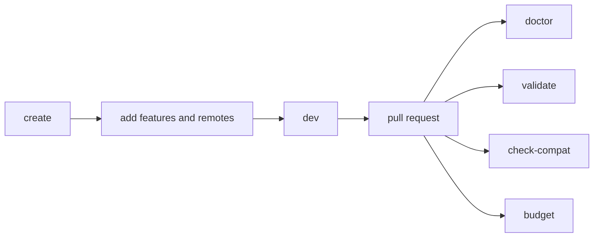

<p align="center">
  
</p>

<p align="center"><strong>The React micro-frontend boilerplate that keeps going after day one.</strong></p>

<div align="center">

[](https://github.com/mfeflow/mfeflow/actions/workflows/ci.yml)
[](https://www.npmjs.com/package/mfeflow)
[](https://sonarcloud.io/summary/new_code?id=mfeflow_mfeflow)
[](https://sonarcloud.io/summary/new_code?id=mfeflow_mfeflow)
[](https://scorecard.dev/viewer/?uri=github.com/mfeflow/mfeflow)
[](LICENSE)

</div>

<p align="center">
  <a href="https://mfeflow.github.io/mfeflow/">Docs</a> &middot;
  <a href="apps/docs/docs/guide/quickstart.md">Getting started</a> &middot;
  <a href="apps/docs/docs/features">Features</a> &middot;
  <a href="packages/cli/CHANGELOG.md">Changelog</a>
</p>

A React micro-frontend platform: a shell, your remotes, and the checks that keep them working together.

Install it with one command. You need Node 22.12 or newer:

```bash
npm create mfeflow@latest my-platform
```

Then start the shell and every remote together:

```bash
cd my-platform
pnpm mfeflow dev
```

You should see something like this, and the shell is at http://localhost:4300:

```text
mfeflow: running shell, catalog, cart. Ctrl+C stops everything.
shell   |   ➜  Local:    http://localhost:4300/
cart    |   ➜  Local:    http://localhost:4312/
catalog |   ➜  Local:    http://localhost:4311/
shell   | ready   built in 0.28s
```

What you get:

- A shell and remotes on Module Federation 2.0 and Rsbuild, with React shared once.
- 25 features you add one at a time, each with a diff you can preview.
- Checks for compatibility, ownership and bundle size that run in CI.
- A static registry: `mfeflow deploy` and `mfeflow rollback` move a pointer, with no rebuild.
- About 5 seconds from create to a running platform, measured.

Read the [docs](https://mfeflow.github.io/mfeflow/) for the full guide.

To grow the project later, add a remote or a feature. Add `--dry-run` to preview the diff:

```bash
pnpm mfeflow add remote checkout
pnpm mfeflow add theming i18n
```

A new remote starts without restarting `mfeflow dev`, and the shell gets its route.

## Why mfeflow

Splitting an app into micro-frontends is easy on day one. The trouble starts a few months later, when several teams ship on their own schedule. These are the problems mfeflow is built around.

| What goes wrong                               | What mfeflow does                                                            |
| --------------------------------------------- | ---------------------------------------------------------------------------- |
| Two copies of React load and hooks break      | React is shared once, and checked at build time and in the browser           |
| Every remote loads its own tag manager        | Analytics and tracing start once, in the shell. Remotes only use them        |
| Remotes drift onto different library versions | A compatibility check compares each remote with its shell, locally and in CI |
| Nobody knows who owns a route                 | Each app has an ownership file, and the CLI validates it                     |
| Bundles creep up unnoticed                    | A size budget flags the shell or a remote when it grows too much             |
| Rolling back means rebuilding                 | `mfeflow rollback` moves the registry pointer back; nothing is rebuilt       |

mfeflow is not for a single team with one app. A plain Rsbuild or Vite project is simpler there.

## Generated project

The default project looks like this, with tests, mocks and small config files left out.

```text
my-platform/
├── mfeflow.json                  # what the CLI created; "add" reads and updates it
├── package.json                  # scripts: dev, build, doctor, validate, check-compat, budget
├── pnpm-workspace.yaml           # one pnpm workspace, versions pinned in a catalog
├── apps/
│   ├── shell/                    # the host app
│   │   ├── mfeflow.app.json              # ownership: who owns this app
│   │   ├── rsbuild.config.ts     # shell preset, port 4300
│   │   ├── public/config/        # runtime config for dev, staging and prod
│   │   └── src/
│   │       ├── bootstrap.tsx     # reads the registry, then registers the remotes
│   │       ├── App.tsx           # layout, navigation, dev overlay (Alt+Shift+M)
│   │       └── remotes/
│   │           └── route-table.tsx   # one route per remote
│   ├── catalog/                  # a remote, port 4311
│   │   ├── mfeflow.app.json              # ownership for this remote
│   │   ├── rsbuild.config.ts     # remote preset
│   │   └── src/exposed/App.tsx   # the component the shell loads
│   └── cart/                     # a second remote, port 4312
├── registry/
│   └── envs/{dev,staging,prod}/  # one JSON file per remote: where its build lives
├── e2e/smoke.spec.ts             # Playwright: open the shell, check each remote renders
└── scripts/check-runtime-config.ts   # checks the runtime config before you deploy
```

## How it works

The shell learns which remotes exist from a registry index. A remote loads only when someone visits its route.



A remote that fails does not take the shell down. The user sees a fallback on that route, and the error is reported.

The path from a new project to CI is short.



The four checks are ordinary commands. The ci-github feature adds a workflow that runs them on every pull request, next to lint, typecheck and tests.

## Features

There are 25 first-party features. Each lives in `features/` and can be added on its own.

**Foundation**

| Feature                                                                       | What it does                                             |
| ----------------------------------------------------------------------------- | -------------------------------------------------------- |
| tsconfig                                                                      | Strict TypeScript 7 presets                              |
| lint-oxlint                                                                   | Type-aware oxlint and Prettier                           |
| [testing](https://mfeflow.github.io/mfeflow/features/testing)                 | Vitest, Testing Library, MSW and a Playwright smoke test |
| git-hooks                                                                     | Commit message and typecheck hooks with lefthook         |
| [commit-prompt](https://mfeflow.github.io/mfeflow/features/commit-prompt)     | An interactive Conventional Commits prompt               |
| [ci-github](https://mfeflow.github.io/mfeflow/features/ci-github)             | A pull request workflow that runs every check            |
| [registry-static](https://mfeflow.github.io/mfeflow/features/registry-static) | Deploy and roll back remotes on a folder or bucket       |
| [release](https://mfeflow.github.io/mfeflow/features/release)                 | Changesets versions each remote, and deploy uses it      |
| [deploy-docker](https://mfeflow.github.io/mfeflow/features/deploy-docker)     | A Dockerfile, nginx config and Kubernetes example        |

**Data and contracts**

| Feature                                                                         | What it does                                               |
| ------------------------------------------------------------------------------- | ---------------------------------------------------------- |
| [env-t3](https://mfeflow.github.io/mfeflow/features/env-t3)                     | Typed env that fails the build when a variable is missing  |
| url-factory                                                                     | Typed API endpoints and URLs                               |
| [http](https://mfeflow.github.io/mfeflow/features/http)                         | A fetch client with timeouts and retries for safe requests |
| [event-bus](https://mfeflow.github.io/mfeflow/features/event-bus)               | Typed events between remotes                               |
| [route-factory](https://mfeflow.github.io/mfeflow/features/route-factory)       | Typed links between remotes                                |
| [data-react-query](https://mfeflow.github.io/mfeflow/features/data-react-query) | One TanStack Query cache owned by the shell                |
| [forms](https://mfeflow.github.io/mfeflow/features/forms)                       | react-hook-form with schema validation                     |

**Observability**

| Feature                                                                           | What it does                                    |
| --------------------------------------------------------------------------------- | ----------------------------------------------- |
| [analytics-gtm](https://mfeflow.github.io/mfeflow/features/analytics-gtm)         | Google Tag Manager with Consent Mode v2         |
| [analytics-clarity](https://mfeflow.github.io/mfeflow/features/analytics-clarity) | Microsoft Clarity, loaded only after consent    |
| [telemetry-otel](https://mfeflow.github.io/mfeflow/features/telemetry-otel)       | OpenTelemetry in the browser, tagged per remote |

**UI**

| Feature                                                           | What it does                                             |
| ----------------------------------------------------------------- | -------------------------------------------------------- |
| [theming](https://mfeflow.github.io/mfeflow/features/theming)     | Light and dark themes owned by the shell                 |
| [i18n](https://mfeflow.github.io/mfeflow/features/i18n)           | One i18next instance, messages shipped with each remote  |
| [tailwind](https://mfeflow.github.io/mfeflow/features/tailwind)   | Tailwind 4 with a class prefix per app                   |
| [ui-shadcn](https://mfeflow.github.io/mfeflow/features/ui-shadcn) | shadcn/ui components copied into each remote             |
| [storybook](https://mfeflow.github.io/mfeflow/features/storybook) | Storybook per remote, all shown in the shell's Storybook |

Third-party features are plain data, never code, and install from any static host. See the [third-party guide](https://mfeflow.github.io/mfeflow/features/third-party).

## Commands

| Command                                  | What it does                                                                                              |
| ---------------------------------------- | --------------------------------------------------------------------------------------------------------- |
| `mfeflow init` (or `npm create mfeflow`) | Create a project: a shell and remotes, in one repo or one repo per team                                   |
| `mfeflow adopt`                          | Set up mfeflow in a Module Federation app you already have                                                |
| `mfeflow add`                            | Add a remote, a shell, a team repo, a feature or a typed env key                                          |
| `mfeflow upgrade`                        | Move a project to the mfeflow version you run, keeping your edits                                         |
| `mfeflow features`                       | List and search features, including ones from your registries                                             |
| `mfeflow dev`                            | Run the shell and every remote, with a dev registry that follows the project                              |
| `mfeflow doctor`                         | Check singletons, compatibility, config and drift. `--fix` repairs the safe ones                          |
| `mfeflow validate`                       | Check the project file, every ownership file and every registry entry                                     |
| `mfeflow check-compat`                   | Compare each remote's shared version ranges with its shell, or, with `--against`, a shell in another repo |
| `mfeflow budget`                         | Measure built JavaScript against the size budget                                                          |
| `mfeflow registry`                       | Add or remove a feature registry, or build one to host                                                    |

Every command takes `--dry-run` and `--json`. Run any command with `--help` for the rest.

## Packages

All 19 are on npm. They are versioned together, so one version number tells you what works with what. The [versioning guide](docs/versioning.md) covers the release flow.

| Package                                          | Role                                                                                      |
| ------------------------------------------------ | ----------------------------------------------------------------------------------------- |
| [mfeflow](packages/cli)                          | The CLI                                                                                   |
| [create-mfeflow](packages/create-mfeflow)        | The `npm create` entry point                                                              |
| [@mfeflow/core](packages/core)                   | The engine behind the CLI: change plans, diffs, atomic apply                              |
| [@mfeflow/contracts](packages/contracts)         | Types and validators for the project, ownership and registry files                        |
| [@mfeflow/registry](packages/registry)           | Static registry core and a self-hosted server: build and gate the index, upload, roll out |
| [@mfeflow/runtime](packages/runtime)             | Registry loading, remote boundaries with fallback, singleton checks                       |
| [@mfeflow/rsbuild](packages/rsbuild)             | Rsbuild presets for the shell and remotes                                                 |
| [@mfeflow/storage](packages/storage)             | Browser storage namespaced per remote                                                     |
| [@mfeflow/theme](packages/theme)                 | Theme tokens as CSS variables                                                             |
| [@mfeflow/i18n](packages/i18n)                   | One i18next instance with per-remote messages                                             |
| [@mfeflow/url-factory](packages/url-factory)     | Typed API URLs                                                                            |
| [@mfeflow/http](packages/http)                   | A small fetch client over typed endpoints                                                 |
| [@mfeflow/event-bus](packages/event-bus)         | A typed event bus with replay for late subscribers                                        |
| [@mfeflow/route-factory](packages/route-factory) | Typed links between remotes                                                               |
| [@mfeflow/analytics](packages/analytics)         | Analytics behind one provider interface                                                   |
| [@mfeflow/telemetry](packages/telemetry)         | Telemetry behind one provider interface                                                   |
| [@mfeflow/testing](packages/testing)             | Test helpers that wrap components in the shell's providers                                |
| [@mfeflow/tsconfig](packages/tsconfig)           | Strict TypeScript presets                                                                 |
| [@mfeflow/oxlint-config](packages/oxlint-config) | Type-aware oxlint rules                                                                   |

## Examples

Two examples show the Phase 06 commands on real files. They are tutorials you can run.

| Example                                   | What it shows                                                                       |
| ----------------------------------------- | ----------------------------------------------------------------------------------- |
| [adopt-existing](examples/adopt-existing) | `mfeflow adopt` on a plain Module Federation app: one Rsbuild shell, two remotes    |
| [polyrepo-teams](examples/polyrepo-teams) | One repo per team: `init --topology polyrepo`, `add team-repo`, shared packages, CI |
| [storefront](examples/storefront)         | The app the benchmarks and end-to-end tests run against                             |

## Numbers

These are measured, and each links to its raw data.

| Measure                                   | Result                                                                                                  | Source                                                                           |
| ----------------------------------------- | ------------------------------------------------------------------------------------------------------- | -------------------------------------------------------------------------------- |
| Create to a shell and two remotes running | About 5 s (median of 5 runs, warm pnpm store, arm64 laptop)                                             | [bench/results/2026-10-31.json](bench/results/2026-10-31.json)                   |
| Rollback visible on a fresh page load     | About 1 s after the command exits, on a local file host (median of 5 runs, arm64 laptop). No CDN, no S3 | [bench/results/2026-11-01-rollback.json](bench/results/2026-11-01-rollback.json) |
| Largest contentful paint, against one app | +160 ms on the catalog page (Lighthouse mobile, simulated, median of 10)                                | [perf-summary.json](examples/storefront/e2e/perf-summary.json)                   |

The CI perf job checks these budgets on pull requests that touch the runtime, the build preset or the storefront. Its run on 2026-11-01 ([run 41312499587](https://github.com/mfeflow/mfeflow/actions/runs/41312499587)):

| Budget                          | Limit   | Measured                       |
| ------------------------------- | ------- | ------------------------------ |
| LCP against a one-app build     | +300 ms | +154 ms                        |
| JavaScript added by the shell   | +32 KB  | +31.1 KB                       |
| JavaScript added by each remote | +10 KB  | catalog +10.0 KB, cart +9.5 KB |

The shell and catalog sit right at their limits. An earlier target of +35 KB for the whole page was replaced by these per-app budgets; the page is still 46 KB over that old target.

## Status and roadmap

Version 0.5.0 is on npm. The feature set (Phase 04) is built.

| Phase | What                                               | State                   |
| ----- | -------------------------------------------------- | ----------------------- |
| 05    | Registry with deploy, promote, rollback and status | Built, not released yet |
| 06    | Upgrade, adopt an existing app, polyrepo layouts   | Built, not released yet |
| Later | More docs, an MCP server                           | Planned                 |

Phase 06 adds these. They are tested, and none is on npm yet:

- `mfeflow upgrade` moves a project to the version you run. It replaces files you did not edit, diffs the ones you did, and never overwrites them without `--accept`. It does not ask npm for a newer version.
- `mfeflow adopt` sets up mfeflow in a Module Federation app you already have. It reads Rsbuild, `module-federation.config` and literal webpack or Rspack configs as text, and never edits a build config. What it cannot read is listed, not guessed.
- `mfeflow init --topology polyrepo` and `mfeflow add team-repo` make one git repo per team. mfeflow writes the repos on your machine and never calls GitHub.
- `mfeflow check-compat --against <url|file>` checks a remote against a shell that lives in another repo, and warns when it has no shell to compare with. `mfeflow doctor --against <url|file>` runs every doctor check with that shell.
- The app file is now `mfeflow.app.json`. `mfe.json` is still read, with a notice, and `upgrade` renames it.

What is still open:

- There is no `mfeflow remove`. Adding a feature is tested. Removing one is not supported.
- The generated GitHub Actions workflow has not yet run on a fresh GitHub repository.
- The MCP server does not exist yet.
- The registry server's Docker image (linux/amd64 and linux/arm64) is built by the release workflow, which has not run for it yet, so there is no image on GHCR until the next release.
- `upgrade` does not work inside a polyrepo yet. It also merges two ways (hash, diff, prompt); a three-way merge is planned.
- `adopt` reads only literal configs. A config built by a function or read from the environment is listed as not carried over. It supports pnpm and npm projects, not yarn or bun. A folder with only a remote and no shell is refused.
- The `hybrid` layout, a platform monorepo with team repos next to it, is not built. `ci-github` and `env-t3` cannot be added to a polyrepo yet.
- `check-compat --against` compares the shell's manifest. Other cross-repo checks are not built.

This section is the status board. Update it in the same pull request that starts or finishes a phase.

## Contributing, security, license

To work on the repo:

```bash
corepack enable
pnpm install
pnpm ci
```

Read [CONTRIBUTING](https://github.com/mfeflow/.github/blob/main/CONTRIBUTING.md) before opening a pull request. Report vulnerabilities as described in [SECURITY](https://github.com/mfeflow/.github/blob/main/SECURITY.md). mfeflow is released under the [MIT license](LICENSE).
